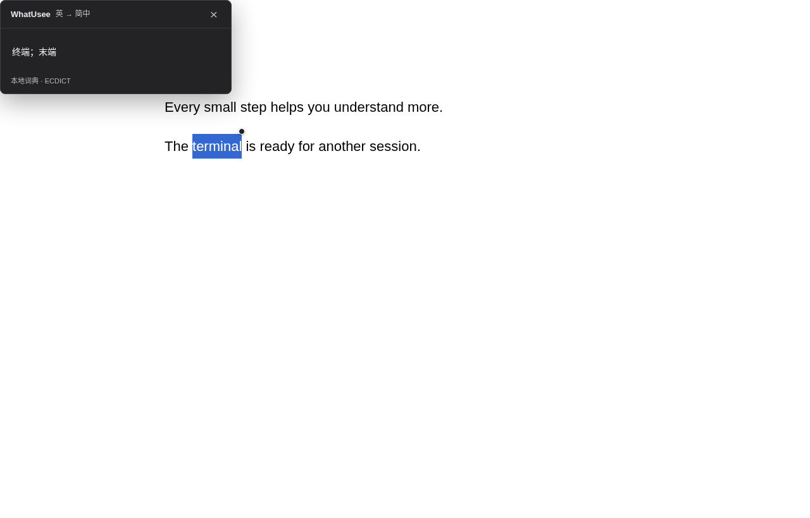
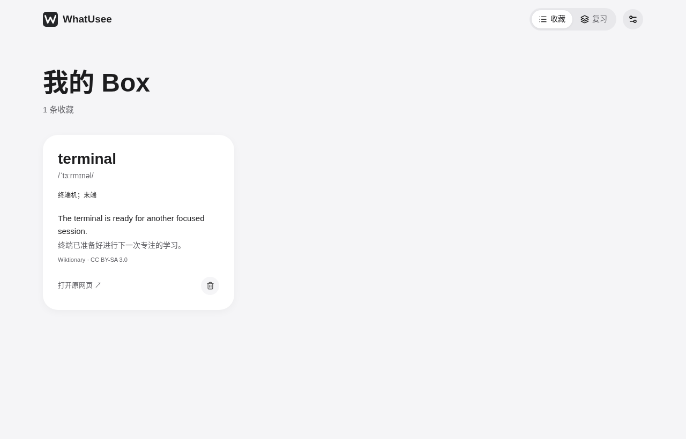
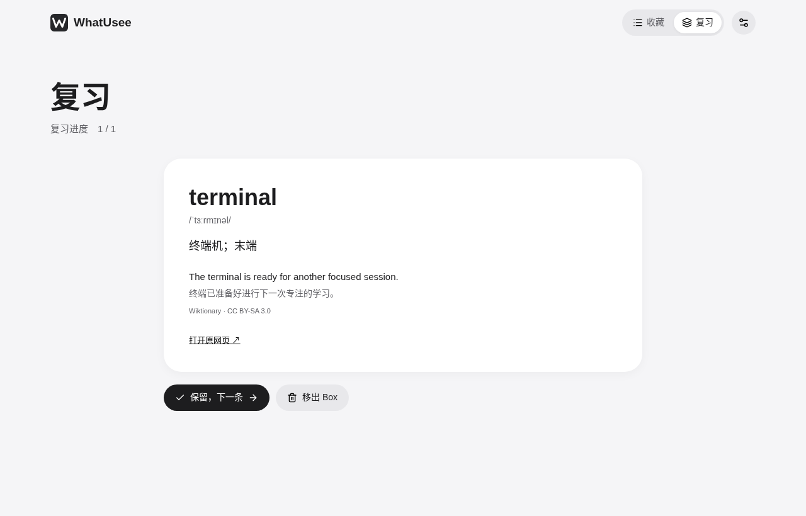

  
  <h1>WhatUsee</h1>
  
读英文网页时，选中即翻译，遇到生词随手收藏，之后放进 Box 复习。

  

    
    
    
  

## 看看它怎么用

选中网页中的英文，悬浮小点查看译文；需要记住的内容可以收入 Box，复习时再决定保留或移出。

  
  
  

划词翻译 · 收藏卡片 · 复习

## 功能

- 选中英文单词或句子，查看中文翻译
- 查看英文例句及其中文译文
- 收藏内容并自动去重
- 在 Box 中复习、保留或移除收藏
- 从收藏卡片打开记录来源的原网页
- 自定义翻译圆点的颜色和位置

## 安装

1. 从本仓库下载代码并解压。
2. 在 Chrome 地址栏打开 `chrome://extensions`。
3. 打开右上角的「开发者模式」。
4. 点击「加载已解压的扩展程序」，选择包含 `manifest.json` 的 `WhatUsee` 文件夹。
5. 打开普通网页，选中一段英文，再将鼠标移到选区旁边的小圆点上。

使用本地文件时，需要在扩展详情中允许访问文件网址。浏览器内部页面和 Chrome 网上应用店页面不允许扩展注入。

## 使用 Box

在翻译框中点击「加入 Box」。点击浏览器工具栏中的 WhatUsee 图标打开 Box，在「收藏」和「复习」之间切换。复习时可查看释义、保留词条或将其移出 Box。新收藏会记录当前网页地址。

## 翻译与隐私

单词释义优先使用随扩展附带的本地词典。在线翻译会将主动选中的文本或例句发送给 MyMemory，例句查询会向 Free Dictionary API 请求公开词典内容。收藏、来源网址和显示设置保存在本机 Chrome 扩展存储中。

详情见[隐私说明](PRIVACY.md)。

## 第三方许可

随附词典和图标的许可文本分别位于 `dict/LICENSE` 和 `icons/LICENSE`。

## 支持项目

Chrome 网上应用店开发者账号需要一次性注册费。如果 WhatUsee 对你有帮助，欢迎自愿支持，用于承担注册费和后续维护。支持完全出于自愿，不影响扩展使用。

收到支持后，我会继续完善 WhatUsee，并在条件具备时提交 Chrome 网上应用店审核。提交后仍需经过 Google 审核，实际上架时间以审核结果为准。

  
  &nbsp;&nbsp;&nbsp;&nbsp;
  

微信支付 · 支付宝

